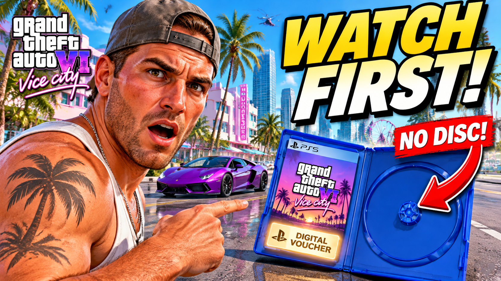
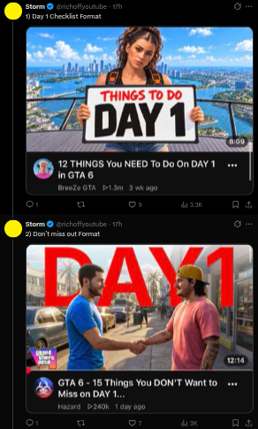
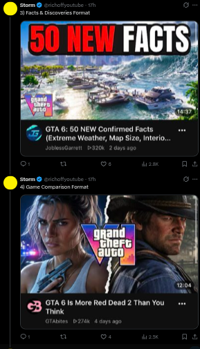
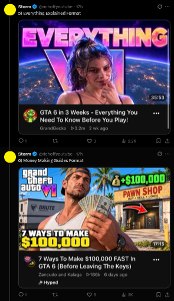
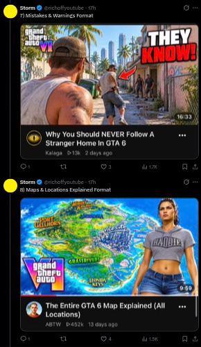
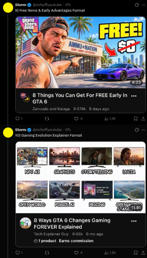

# Creator Preferences & Production Style Guide (Read First!)

> **For AI Agents:** Read this entire file **and visually inspect the embedded thumbnail references below** before writing any script, choosing a voice, mixing audio, or generating thumbnails for this channel. These are the creator's explicit, tested preferences from real rendered videos — follow them by default so the creator never has to repeat themselves.

---

## 0. Quick Defaults (Non-Negotiable Checklist)

1. **Simple, natural, 9-year-old-friendly English** — zero stiff journalist speak, zero "old man" analogies, zero jargon.
2. **Brisk, natural-pitch voice** — speed up slightly (`1.18×`) and lower/warm the pitch (`-1.75` semitones + warm EQ, `0.22s` max silence trim) so TTS never sounds slow or squeaky/high-pitched.
3. **Always include non-copyrighted background music** — verified **CC0 1.0 Universal** or **Public Domain Mark 1.0** tracks only (zero Content ID risk), smoothly crossfaded and sidechain-ducked cleanly under the narration.
4. **Zero black frames & zero logo endplates** — drop Rockstar `"PRESENTS"`, `"VI"`, ESRB, and blank logo slates; keep moving official gameplay playing end-to-end.
5. **Compact floating PiP prop cards** — crisp pure-white `#FFFFFF` studio object props (no people) in the top-right corner (`520×370`) over unblurred live gameplay.
6. **High-CTR sunny action-curiosity thumbnails** — expressive foreground GTA character pointing at a concrete visual twist/prop, bright red curved arrow + punchy red badge, giant yellow-to-white slanted outlined 2-word headline, bright sunny Vice City backdrop (see Section 5 & embedded screenshots).
7. **Always render via GitHub Actions cloud workflows** (`vicecut-preview.yml` and `vicecut-final.yml` with `publish_draft_release: true`) so downloadable `final_1080p.mp4` and `<25 MB` `mobile_under_25mb.mp4` links are ready immediately.

---

## 1. Script & Writing Style

- **Target reading vibe:** Natural, fun, everyday spoken English — **as if explaining clearly to a 9-year-old**.
- **What to AVOID:**
  - Do **not** use complex "old man" analogies, finance/corporate metaphors, or stiff gaming-journalist phrasing.
  - Do **not** pad sentences with fancy filler words when a 4-word everyday sentence says it better.
- **Concrete Good vs. Bad Examples:**
  - **Bad:** *"Two hundred twelve gigabytes represents an unprecedented storage footprint that forces a ruthless triage of your console library."*
  - **Good:** *"Two hundred twelve gigs is giant. Like four big games combined. So delete old games tonight until you have two hundred fifty gigs free."*
  - **Bad:** *"Physical retail editions effectively serve as decorative shelf artifacts housing redemption vouchers."*
  - **Good:** *"There is no disc inside the box — just a download code. So you basically pay for an empty plastic box to look at while your download finishes."*
- **Fact & Quality Discipline:**
  - Keep **100% verified, same-day real facts** (official sources, zero rumors presented as facts, zero leaks as evidence).
  - Pass both `vicecut audit-research` and `vicecut check` (all checks green) before recording voice.
  - Keep hook fast (value in Line 1), simple teasers that actually pay off, and a punchy either/or closing question for comments.

---

## 2. Voice & Audio Mastering Defaults

The creator prefers a **snappy, energetic, natural-sounding voice** — **not slow** and **not overly high-pitched**.

Default `project.yaml` voice mastering settings (proven in V3 `ViceCut Master #6`):

```yaml
voice:
  provider: arena          # or kokoro if generating locally/cloud
  voice_id: voice-02       # preferred male narrator voice
  language: en-US
  speed_override: 1.18     # brisk, engaging pace (never slow/dragging)
  pitch_semitones: -1.75   # lowers high-pitched edge cleanly without sounding robotic
  max_silence_s: 0.22      # trims awkward pauses between sentences
  whisper_model: base.en
```

**Important TTS Pronunciation Note:**
- When generating speech with modern neural/Arena TTS (`voice-02`), pass **clean natural English spelling** (`GTA 6`, `PS5`, `Xbox Series X and S`, `PC`, `Leonida`, `2026`). Do **not** inject spaced phonetic hacks (`"G T A"`, `"P S five"`, `"Lee-oh-nee-dah"`), which create robotic pauses.
- Master final narration to **`-18 LUFS`** with warm vocal EQ (`+1.6 dB` around 210 Hz, gentle `-1.6 dB` high shelf around 6.8 kHz) and duration-preserving pitch shift so word-aligned captions stay at `0.0 ms` drift.

---

## 3. Non-Copyrighted Background Music Defaults

Every video **must** have upbeat, non-copyrighted background music mixed subtly under the voice.

- **License Requirement:** Strictly **CC0 1.0 Universal (Public Domain Dedication)** or **Public Domain Mark 1.0** with verifiable Archive.org / official license metadata.
  - **WARNING:** Never use random "No Copyright Music" uploads without checking reviews/license tags (e.g., Nver Avetyan's `royalty-free-music` triggers Content ID despite its title — rejected).
- **Verified Default GTA 6 / Vice Neon CC0 Playlist** (automatically fetched & crossfaded by `vicecut media-fetch` via `fetch_plan.yaml`):
  1. *Loyalty Freak Music — Everyone is so alive* (CC0 1.0 — upbeat synthwave/house intro & prep)
  2. *Loyalty Freak Music — One Cool Minute* (CC0 1.0 — chill electro bounce middle)
  3. *Loyalty Freak Music — After Party* (CC0 1.0 — smooth synthwave outro)
  4. *Fallback:* 10-Minute Lo-Fi Chill Instrumental Beat (Public Domain Mark 1.0)
- **Mix Spec (built into `src/vicecut/render.py`):**
  - Each track normalized to `-18 LUFS` 48 kHz stereo and joined with `2.5s` smooth crossfades.
  - Warm low-pass rolloff (`highpass=45 Hz, lowpass=6500 Hz`) so music stays smooth behind speech.
  - Mixed at `-14 dB` with **automatic voice-keyed sidechain ducking (`sidechaincompress`)**, `1.5s` fade-in, `2.5s` fade-out, and clean output limiter (`alimiter=limit=0.89`).
  - Automatically credited in `credits.md`.

---

## 4. Visual Editing & Graphics Defaults

- **Zero Black Frames:** Never let the background fall back to blank dark solid frames; `render_background_cuts_track()` recycles earliest-used real shots with subtle zoom push-in instead.
- **Drop Logo / Rating Plates Early:** Immediately drop any Rockstar `"PRESENTS"`, `"VI"` end-card, ESRB rating screen, or fade-to-black plates using `vicecut media-drop`.
- **Prop Cards (`[CARD:prop|...]`):**
  - Render as compact **`520×370`** top-right Picture-in-Picture cards over **unblurred** moving gameplay.
  - Prop artwork must sit on a **pure `#FFFFFF` studio background** with **zero humans/faces** — clean physical objects only (consoles, SSD, game box, globe, controller, price tag, TV, compass).

---

## 5. High-CTR Thumbnail Style Guide & Visual References

### Approved Gold-Standard Example (What the Creator Picked!)

File path: `projects/gta6-before-you-play/thumbnails/thumb_03_watch_first_warning.png`



**Why this thumbnail won (and what to replicate on every future video):**
1. **Bright, Hyper-Saturated Daylight Vice City Backdrop:** Vibrant blue sky, sunny Miami palms, neon purple supercar — pops violently against YouTube's dark-mode feed.
2. **Expressive Foreground GTA Character Pointing at the Payoff:** Close-up left-side character (Jason/Lucia energy) with a genuine shocked/urgent facial expression + finger pointing directly at the main curiosity prop.
3. **Concrete Visual Curiosity Twist (Understood in 0.2 Seconds):** The open blue PS5 game box with a glowing `DIGITAL VOUCHER` card and an **empty disc tray** immediately tells a story without needing a paragraph.
4. **Glossy Red Curved Arrow + High-Urgency 2-Word Red Badge:** Directs the viewer's eye straight to the twist (`NO DISC!`).
5. **Giant Slanted Yellow-to-White Bold Outlined 2-Word Headline:** (`WATCH FIRST!`) — massive, ultra-thick black outline, crisp contrast, readable even on a tiny phone screen.
6. **Clean Game Identity + Safe Timestamp Zone:** Recognizable GTA VI badge in the top-left; bottom-right corner kept clean so YouTube's duration pill never covers key text.

**What the Creator Skipped (Lower Priority):**
- Calmer/darker portrait-only compositions (e.g., Lucia floating over night space with a single word) and static whiteboard-sign poses were passed over in favor of the **high-energy pointing character + visual surprise prop + red arrow + yellow/red high-contrast warning style**. Always include this energetic action-curiosity style as your primary thumbnail direction!

---

### Creator's 5 Viral Reference Screenshots (10 Proven GTA 6 Formats)

> **For AI Agents:** Call `read_file` on the PNG paths below whenever designing thumbnails or pitching new GTA 6 video formats so you match the exact CTR grammar shown here.

#### Reference 1 — Format #1 (Day 1 Checklist, 1.3M views) & Format #2 (Don't Miss Out, 240K views)
Path: `docs/references/thumbnails/ref_01_day1_checklist_and_dont_miss.png`



- **Takeaways:** Bright sunny Vice City aerial backdrop (high dark-mode pop); giant 2-word foreground/background `DAY 1` typography; ultra-simple focal subject.

#### Reference 2 — Format #3 (50 New Facts, 320K views) & Format #4 (Game Comparison Split, 274K views)
Path: `docs/references/thumbnails/ref_02_facts_and_game_comparison.png`



- **Takeaways:** Huge red+white outlined top banner (`50 NEW FACTS`) over dramatic action scenery; torn-paper split-screen comparisons with centered GTA VI logo.

#### Reference 3 — Format #5 (Everything Explained, 3.2M views) & Format #6 (Money Making Guides, 186K views)
Path: `docs/references/thumbnails/ref_03_everything_explained_and_money_guide.png`



- **Takeaways:** Proven 3.2M-view title structure (*"GTA 6 in X Days - Everything You Need To Know Before You Play!"*); foreground rugged Jason holding props + bright red arrow + giant neon green/yellow money badges.

#### Reference 4 — Format #7 (Mistakes & Warnings) & Format #8 (Maps & Locations, 452K views)
Path: `docs/references/thumbnails/ref_04_mistakes_warnings_and_map_guide.png`



- **Takeaways:** Urgent red/white warning text (`THEY KNOW!`) + red arrow pointing at the danger; bright saturated 3D map cutout paired with foreground character.

#### Reference 5 — Format #9 (Free Items & Early Advantages, 374K views — #1 Visual DNA Match!) & Format #10 (Gaming Evolution Grid)
Path: `docs/references/thumbnails/ref_05_free_items_and_evolution_explainer.png`



- **Takeaways:** **Core inspiration behind the creator's favorite thumbnail style** — left foreground shocked protagonist pointing right, vibrant sunny Vice City backdrop + purple sports car, thick curved red arrow, massive outlined yellow text (`FREE!` / `WATCH FIRST!`), and unmistakable red/white visual hook (`$0` / `NO DISC!`).

---

## 6. YouTube Title, Description & Tags Rules

- **Title ↔ Thumbnail Synergy (No Redundancy):** Never waste title characters repeating the exact words already printed giant on the thumbnail (`WATCH FIRST!` / `NO DISC!`). Pair an intriguing visual thumbnail with a clean, searchable, curiosity-driven title.
- **Mobile-Safe Title Length:** Keep the primary title around **55–65 characters** so the core hook never gets cut off on phones. Always provide **1 primary winner + 2 A/B test alternatives** for YouTube Test & Compare.
- **Description Style:**
  - First 2 lines (above the "Show more" fold) must immediately hook viewers and naturally include primary keywords (`GTA 6`, `before you play`, `launch`, `PS5`, `Xbox`).
  - Include clean chapter timestamps, short bulleted takeaway summary, official source links, and CC0 music credits.
- **Tags:** Keep under YouTube's **500-character limit**, mixing high-volume core terms (`GTA 6`, `Grand Theft Auto 6`, `GTA 6 launch`) with specific long-tail search phrases (`GTA 6 212 GB`, `GTA 6 New Zealand trick`, `GTA 6 no disc`, `GTA 6 before you play`).
